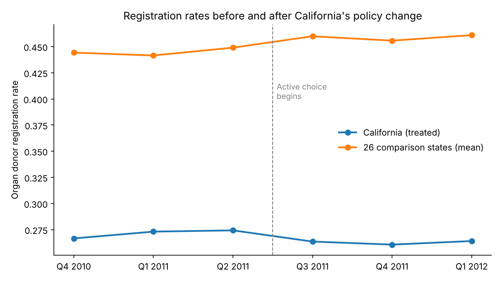
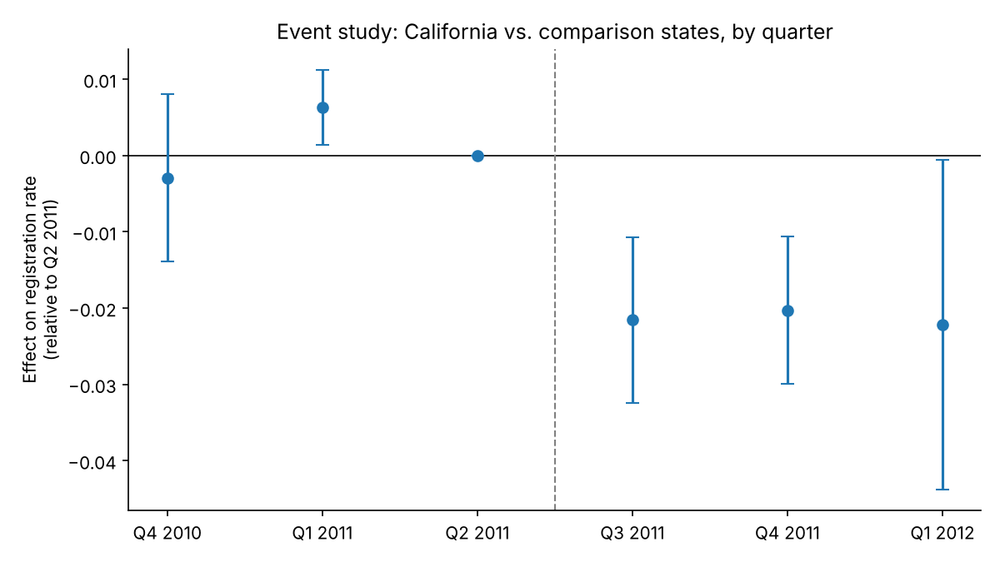
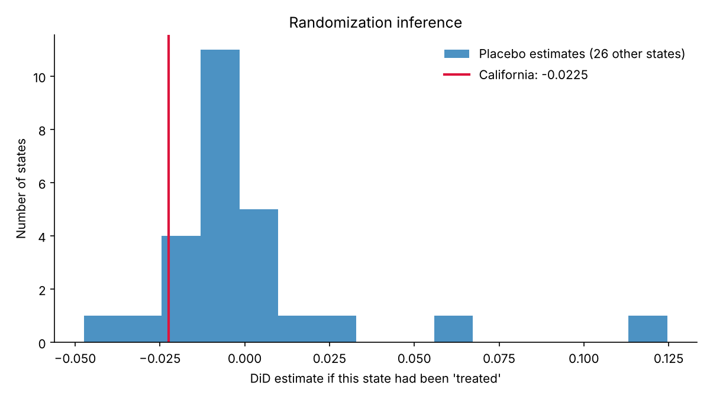

# Did "Active Choice" Change Organ Donor Registration? A Difference-in-Differences Study

**Question:** In July 2011, California started requiring drivers'-license applicants to *actively answer* whether they wanted to register as organ donors. Behavioral economics suggests that prompting a choice should raise sign-ups. Did it?

**Method:** Difference-in-differences (DiD), comparing California to 26 states that made no policy change. I check the result with an event study, randomization inference and a placebo test.

**Bottom line:** California's registration rate fell by **2.2 percentage points** (about 8%) relative to comparison states. However, with only one treated state, standard clustered errors overstate the certainty. **Randomization inference gives p = 0.19**, so the honest conclusion is *no evidence that active choice increased registrations, with suggestive evidence of a decrease*.

---

## Data

| | |
|---|---|
| Source | Kessler & Roth (2014), via the [`causaldata`](https://pypi.org/project/causaldata/) package |
| Unit | State × quarter |
| Panel | 27 states × 6 quarters (Q4 2010 to Q1 2012) = 162 rows |
| Outcome | Share of license applicants registered as organ donors |
| Treatment | California, from Q3 2011 onward |

## Approach

### 1. Look at the raw trends first


Before the policy, California and the comparison states move roughly in parallel, although at very different levels. DiD only needs the **trends** to be parallel, not the levels. After the policy, the comparison states keep rising while California dips.

### 2. 2×2 DiD by hand

| | Pre | Post | Change |
|---|---|---|---|
| Comparison states | 0.4449 | 0.4589 | +0.0139 |
| California | 0.2713 | 0.2628 | −0.0085 |
| **DiD** | | | **−0.0225** |

The comparison states' change (+1.4 pp) estimates what *would have happened* in California without the policy. California fell 0.85 pp instead, so the estimated effect is −0.85 − 1.39 = **−2.25 pp**.

### 3. Two-way fixed effects regression

`Rate ~ California×Post + state FE + quarter FE`, with SEs clustered by state:

| | Estimate | SE | 95% CI |
|---|---|---|---|
| California × Post | −0.0225 | 0.0067 | [−0.036, −0.009] |

State fixed effects absorb permanent level differences (California's much lower baseline). Quarter fixed effects absorb nationwide shocks that hit every state at once.

### 4. Event study: is the parallel-trends assumption believable?


Each dot is California's gap relative to the last pre-policy quarter (Q2 2011). Ideally the pre-period dots sit at zero and the effect appears only after the policy.
- **After the policy:** a stable drop of about 2 pp in all three quarters, a clean, persistent shift rather than noise.
- **Before the policy:** Q1 2011 is slightly above zero (+0.6 pp). The joint pre-trend test is borderline (p = 0.048), so parallel trends is **plausible but not airtight**. I flag this rather than hide it.

### 5. Randomization inference: the most important robustness check


**The problem:** there is only **one treated state**. Clustered standard errors assume many treated clusters, so with one they are far too confident.

**The fix:** re-run the DiD 27 times, each time pretending a different state was the "treated" one. If California's real estimate is extreme compared with these placebo estimates, the effect is credible.

**Result:** California ranks **5th of 27** in absolute size, so **permutation p = 0.185**. California's drop is large, but not unusual compared with ordinary state-to-state noise.

### 6. Placebo in time
Using only pre-policy data, I pretend the policy started in Q1 2011. The estimate is +0.006 (95% CI [−0.006, 0.018]), so there is no fake "effect" where none should exist.

## Conclusion

| Check | Result |
|---|---|
| Point estimate | −2.2 pp (−8%) |
| Clustered SE | Significant, but unreliable with one treated unit |
| Event study | Effect appears right at the policy date and persists |
| Pre-trends | Mostly flat, one borderline quarter |
| Randomization inference | **p = 0.19, not significant** |
| Placebo in time | No false effect |

**Decision-maker takeaway:** the data give **no support** for the claim that active choice raised registrations. If anything, they point the other way. That finding goes against the behavioral-economics intuition, and it matches Kessler & Roth's original paper. Given a single treated state, I would describe the decline as *suggestive*, and a confirmatory test (for example a synthetic control or a second adopting state) would be the next step.

## What this project demonstrates
- Setting up a causal question with a clear counterfactual
- 2×2 DiD, two-way fixed effects and event-study (dynamic) specifications
- Testing identifying assumptions (parallel pre-trends, placebo-in-time)
- **Choosing inference that fits the design.** Randomization inference matters when treated units are few, and spotting this changed the conclusion.
- Reporting uncertainty honestly instead of headlining the most favorable p-value

## Reproduce

```bash
pip install -r requirements.txt
python src/did_analysis.py
```
This writes figures to `figures/` and the full numeric output to [`results/results.md`](results/results.md).

## Reference
Kessler, J. B., & Roth, A. E. (2014). *Don't Take 'No' for an Answer: An Experiment with Actual Organ Donor Registrations.* NBER Working Paper 20378.
